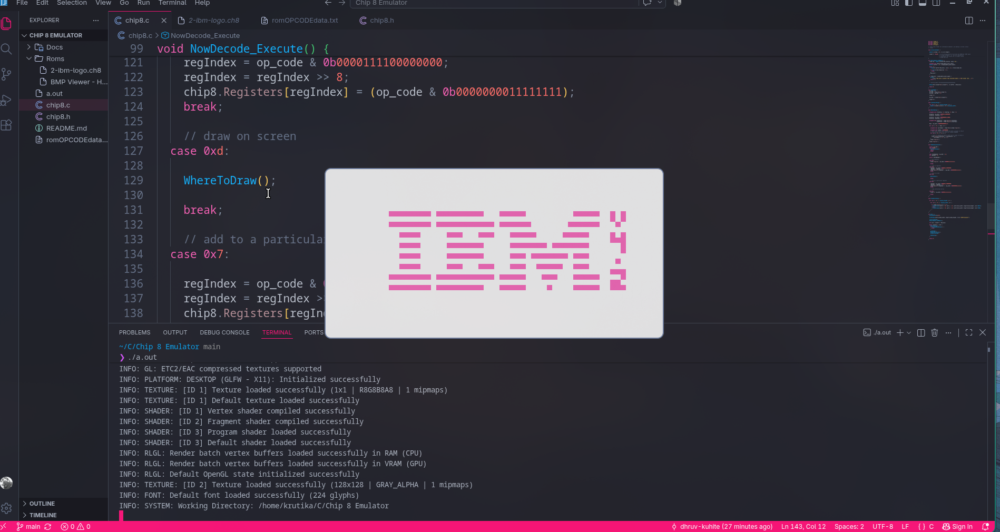

# CHIP-8 Emulator

> 🚧 **Currently Building**

Check the **`/Docs`** folder for my handwritten notes. Everything I make in this emulator will be documented there.

* **Guide:** `chip 8 guide by Dhruv Kuhite.pdf` (located in `/Docs`) — Everything I am making is listed in this guide.
* **Note:** If the PDF doesn't load in your browser, please download it directly to view.

## CHIP-8 Emulator Current Update

Successfully executing and rendering the IBM Logo ROM.

